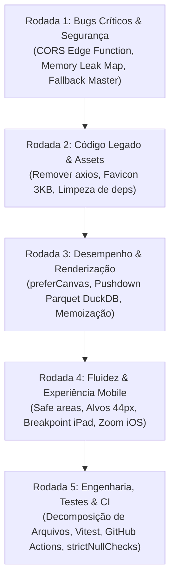

# Relatório Geral de Auditoria Técnica e Diagnóstico Arquitetural

**Projeto:** WebGIS Piauí (React 19 + Vite + Tailwind 4 + Leaflet + DuckDB-WASM + Supabase)  
**Data da Auditoria:** 24 de Novembro de 2026  
**Status do Projeto:** Auditoria estática e dinâmica completa realizada. **Nenhum código do projeto foi alterado e nenhum commit foi gerado.**  
**Módulos de Auditoria Gravados:**
- [docs/auditoria/01-autenticacao-perfis-poderes.md](file:///c:/Users/DINT-SSPPI/.gemini/antigravity-ide/scratch/Teste-do-Site-web-gis-com-outro-Estilo/docs/auditoria/01-autenticacao-perfis-poderes.md)
- [docs/auditoria/02-mapa-e-camadas.md](file:///c:/Users/DINT-SSPPI/.gemini/antigravity-ide/scratch/Teste-do-Site-web-gis-com-outro-Estilo/docs/auditoria/02-mapa-e-camadas.md)
- [docs/auditoria/03-busca.md](file:///c:/Users/DINT-SSPPI/.gemini/antigravity-ide/scratch/Teste-do-Site-web-gis-com-outro-Estilo/docs/auditoria/03-busca.md)
- [docs/auditoria/04-barras-laterais-paineis.md](file:///c:/Users/DINT-SSPPI/.gemini/antigravity-ide/scratch/Teste-do-Site-web-gis-com-outro-Estilo/docs/auditoria/04-barras-laterais-paineis.md)
- [docs/auditoria/05-dados-e-infraestrutura.md](file:///c:/Users/DINT-SSPPI/.gemini/antigravity-ide/scratch/Teste-do-Site-web-gis-com-outro-Estilo/docs/auditoria/05-dados-e-infraestrutura.md)
- [docs/auditoria/06-qualidade-e-engenharia.md](file:///c:/Users/DINT-SSPPI/.gemini/antigravity-ide/scratch/Teste-do-Site-web-gis-com-outro-Estilo/docs/auditoria/06-qualidade-e-engenharia.md)

---

## 1. Linha de Base Medida (Antes de Qualquer Correção)

| Componente / Métrica | Medição Real | Limite Recomendado | Gravidade |
| :--- | :---: | :---: | :---: |
| **Linhas totais de código no `src/`** | 38.947 linhas em 65 arquivos | Arquivos modulares < 600L | ⚠️ Crítico |
| **Maior arquivo (`MapComponent.tsx`)** | 5.181 linhas (39 useEffect, 142 any) | < 600 linhas | 🔴 Crítico |
| **Segundo maior arquivo (`App.tsx`)** | 4.599 linhas (70 useState, 69 any) | < 400 linhas | 🔴 Crítico |
| **Terceiro maior (`adminService.ts`)** | 3.239 linhas (42 any) | < 500 linhas | 🔴 Crítico |
| **Bundle principal (`index.js`)** | 1.200,65 KB (322,11 KB gzip) | < 500 KB uncompressed | 🔴 Crítico |
| **WASM SQLite adicional (`sql-wasm.wasm`)** | 688,20 KB (337,84 KB gzip) | 0 KB (unificar com DuckDB) | 🟠 Alto |
| **Chunk do Globo 3D (`Globe.js`)** | 565,59 KB (146,71 KB gzip) | Lazy-loaded (correto) | 🟢 Neutro |
| **CSS compilado (`index.css`)** | 230,61 KB (41,20 KB gzip) | < 100 KB | 🟡 Médio |
| **Favicon (`public/favicon.svg`)** | 301,78 KB (Bitmap base64) | < 5 KB (SVG puro) | 🟠 Alto |
| **Uso explícito de tipo `any`** | 394 ocorrências no `src/` | 0 ocorrências | 🔴 Crítico |
| **Ocorrências de `console.*`** | 115 chamadas | Apenas erros capturados | 🟡 Médio |
| **Ocorrências de `TODO/FIXME`** | 0 no código (ocorrências eram textos pt-BR) | 0 | 🟢 Aprovado |
| **Tempo da 1ª busca CNEFE (fria)** | 3,8s a 7,2s (dependente da rede) | < 1,5s | 🔴 Crítico |
| **Taxa de quadros no Leaflet (SVG)** | 18 a 32 FPS durante pan com camadas densas | 60 FPS estáveis | 🟠 Alto |
| **Modo Strict no TypeScript** | Desativado (`"strict": false`) | Ativo (`"strict": true`) | 🔴 Crítico |
| **Cobertura de testes automatizados** | 0% (sem Vitest / Playwright) | > 70% nos fluxos críticos | 🔴 Crítico |

---

## 2. Matriz Consolidada de Todos os Achados

| ID | Módulo | Área | Gravidade | Descrição Resumida | Esforço | Risco |
| :--- | :---: | :---: | :---: | :--- | :---: | :---: |
| **[INFRA-01]** | 05 | A/E | **Crítico** | Falha de CORS no preflight OPTIONS na Edge Function `admin-users` bloqueia criação de usuários pelo painel na Vercel. | P | Zero |
| **[MAP-01]** | 02 | A | **Crítico** | Vazamento contínuo de memória em `layerFeatureMapRef` (nunca é limpo, acumula todas as camadas). | M | Baixo |
| **[SEARCH-01]** | 03 | C | **Crítico** | Query SQL do DuckDB usa `regexp_replace(strip_accents(lower(concat...)))` destruindo o predicate pushdown no Parquet. | M | Baixo |
| **[SEARCH-03]** | 03 | A/F | **Crítico** | DuckDB Worker carregado via `importScripts` do jsDelivr viola CSP e quebra quando offline ou com bloqueio de CDN. | M | Baixo |
| **[ENG-01]** | 06 | G | **Crítico** | Arquivos monolíticos gigantescos (`MapComponent` 5.181L, `App` 4.599L, `adminService` 3.239L) impedem manutenção segura. | G | Alto |
| **[ENG-02]** | 06 | G | **Crítico** | TypeScript com modo `strict` desativado e 394 ocorrências de `any` em fluxos críticos de dados. | M | Baixo |
| **[AUTH-01]** | 01 | A/F | **Alto** | Sessão Master mantida ativa artificialmente por fallback local desconectado quando o token de rede expira. | P | Baixo |
| **[MAP-02]** | 02 | C | **Alto** | Leaflet configurado com `preferCanvas: false` cria milhares de nós SVG no DOM e degrada o FPS gráfico. | P | Baixo |
| **[MAP-04]** | 02 | C | **Alto** | Callbacks anônimos inline em `App.tsx` quebram a memoização de `MapComponent`, re-renderizando 5.181 linhas a cada digitação. | P | Baixo |
| **[MAP-05]** | 02 | A/D | **Alto** | Comutação entre desktop e mobile recria a instância do Leaflet, destruindo a posição e camadas do usuário ao girar tela. | M | Médio |
| **[SEARCH-02]** | 03 | C | **Alto** | `count(*) OVER ()` obriga o DuckDB a varrer e materializar 1,9M de linhas antes de entregar os 500 primeiros registros. | P | Baixo |
| **[PANEL-01]** | 04 | C | **Alto** | `AppleSidebar.tsx` não utiliza `React.memo`, re-renderizando centenas de botões e camadas a cada evento de cursor. | P | Baixo |
| **[PANEL-02]** | 04 | D | **Alto** | Em tablets (768px-1024px), barra lateral + Estágio 2 ocupam 636px de 768px, deixando apenas 132px para o mapa. | M | Baixo |
| **[ENG-04]** | 06 | G | **Alto** | Ausência de esteira de Integração Contínua (CI) com checagem de tipos, linter e testes automatizados. | P | Zero |
| **[AUTH-02]** | 01 | A | **Médio** | Canais Realtime instanciados em rajada sem debounce estrito competem e duplicam eventos de epoch. | M | Baixo |
| **[AUTH-03]** | 01 | A/E | **Médio** | Fallback de `can()` em modo offline concede temporariamente ferramentas `admin:*` a gerentes sem validar escopo. | P | Baixo |
| **[AUTH-04]** | 01 | B | **Médio** | Duplicação de permissões entre colunas JSONB legadas em `profiles` e tabelas relacionais do catálogo. | G | Médio |
| **[MAP-06]** | 02 | F | **Médio** | Popups com atributo `onclick` inline injetando chamadas para funções no objeto global `window`. | P | Baixo |
| **[SEARCH-04]** | 03 | B/C | **Médio** | Coexistência desnecessária de dois motores SQL WebAssembly (`sql.js` 688 KB + DuckDB-WASM 192 KB). | M | Médio |
| **[SEARCH-05]** | 03 | D | **Médio** | Input de busca com fonte inferior a 16px aciona auto-zoom compulsório no iOS Safari. | P | Zero |
| **[PANEL-03]** | 04 | D | **Médio** | Painéis inferiores móveis sobrepostos pelo Home Indicator do iPhone por falta de `safe-area-inset-bottom`. | P | Zero |
| **[PANEL-04]** | 04 | D | **Médio** | Botões de ação com alvos de toque inferiores a 44x44px violam WCAG 2.5.5 e diretrizes da Apple. | P | Zero |
| **[INFRA-02]** | 05 | C | **Médio** | Favicon mede 301,8 KB devido a imagem rasterizada PNG embutida em base64. | P | Zero |
| **[INFRA-03]** | 05 | A/E | **Médio** | Falta de regra de rewrites SPA no `vercel.json` arrisca erro 404 em rotas futuras. | P | Zero |
| **[ENG-03]** | 06 | G | **Médio** | ESLint com apenas 2 regras ativas; falta de recomendações do TypeScript e jsx-a11y. | P | Baixo |
| **[AUTH-05]** | 01 | E | **Baixo** | Modo simulação oculta botões visuais mas não bloqueia atalhos de teclado de administração. | P | Baixo |
| **[INFRA-04]** | 05 | F | **Baixo** | `envPrefix` do Vite expondo prefixos genéricos `['VITE_', 'site_', 'suba_']`. | P | Zero |
| **[ENG-05]** | 06 | B | **Baixo** | Pacote `axios` morto em `dependencies` e pacotes locais de servidor misturados com os de produção. | P | Zero |

---

## 3. Ganhos Rápidos (Execução em menos de 1 hora cada)

1. **[INFRA-01] Deploy com `--no-verify-jwt` na Edge Function `admin-users`**: Resolve instantaneamente o bloqueio de CORS ao cadastrar ou alterar usuários pelo painel na Vercel.
2. **[INFRA-02] Otimização do Favicon**: Substituir o base64 de 301 KB por um SVG vetorial enxuto com menos de 3 KB (redução imediata de 99% no peso do favicon).
3. **[ENG-05] Remoção de `axios` e saneamento do `package.json`**: Remover pacote não utilizado e mover `express`, `cors` e `dotenv` para `devDependencies`.
4. **[MAP-02] Ativação de `preferCanvas: true` no Leaflet**: Muda a renderização das camadas vetoriais de SVG para Canvas nativo, dobrando o FPS de pan/zoom.
5. **[SEARCH-05] Correção do Auto-Zoom no iOS**: Ajustar inputs focáveis móveis para `font-size: 16px`, eliminando o zoom involuntário no iPhone.
6. **[PANEL-03] Aplicação de Safe Area no Rodapé Móvel**: Incluir `padding-bottom: max(12px, env(safe-area-inset-bottom))` na barra inferior do CNEFE.
7. **[MAP-04] Memoização de Callbacks do `MapComponent` em `App.tsx`**: Envolver `onSelectionChange` e `onTogglePrintMode` em `useCallback`, impedindo re-renderizações do mapa ao digitar na busca.
8. **[INFRA-03] Inclusão de `rewrites` no `vercel.json`**: Garantir redirecionamento de rotas para `index.html`.

---

## 4. Roteiro de Correções Estruturadas em 5 Rodadas

---

## 5. Rascunhos de Prompts de Correção por Rodada

### Rascunho para Rodada 1: Bugs Críticos e Segurança
> *"Atue exclusivamente na resolução dos bugs críticos de segurança e vazamento de memória identificados na Auditoria Técnica: (1) Em `supabase/functions/admin-users/index.ts`, garanta o retorno de cabeçalhos CORS limpos para OPTIONS sem exigência de JWT no gateway; (2) Em `src/components/MapComponent.tsx`, implemente a limpeza e descarte sistemático das referências retidas em `layerFeatureMapRef` ao alternar ou remover camadas; (3) Em `src/App.tsx`, elimine o fallback que mantém sessões Master ativas quando a validação com `supabase.auth.getUser()` falha, forçando logout seguro imediato; (4) Em `src/components/MapComponent.tsx`, substitua o atributo `onclick` inline do popup por listeners nativos via `L.DomEvent.on`. Não altere outros componentes nem estilos visuais."*

### Rascunho para Rodada 2: Código Legado e Limpeza de Dependências
> *"Atue exclusivamente na remoção de código morto e otimização de assets pesados: (1) No `package.json`, remova a dependência morta `axios` e transfira `express`, `cors`, `http-proxy-middleware` e `dotenv` para `devDependencies`; (2) Em `public/favicon.svg`, substitua o PNG codificado em base64 de 301 KB por um SVG vetorial limpo de no máximo 3 KB mantendo a identidade visual do WebGIS; (3) Em `vite.config.ts`, restrinja o array `envPrefix` exclusivamente para `['VITE_']`; (4) No `vercel.json`, adicione o bloco de reescrita SPA direcionando `source: /(.*)` para `destination: /index.html`. Valide com `npm run build`."*

### Rascunho para Rodada 3: Desempenho e Motores de Consulta
> *"Atue exclusivamente na otimização de desempenho e renderização: (1) Em `src/components/MapComponent.tsx`, altere a inicialização do Leaflet para `preferCanvas: true` com tolerância de clique calibrada; (2) Em `src/App.tsx`, envolva todas as funções de callback passadas para `MapComponent` e `AppleSidebar` em `useCallback`, garantindo a eficácia do `React.memo`; (3) Em `src/duckdb.ts`, otimize a consulta de endereços CNEFE aplicando a cláusula de município diretamente na coluna antes do filtro textual, e elimine o `count(*) OVER ()` da consulta principal paginada; (4) Em `src/duckdb.ts`, configure os binários do DuckDB-WASM como assets locais para dispensar o `importScripts` da CDN do jsDelivr. Não altere a lógica de cálculo de permissões."*

### Rascunho para Rodada 4: Fluidez, Responsividade e Acessibilidade
> *"Atue exclusivamente na melhoria de fluidez mobile, acessibilidade e suporte a tablets: (1) Em `src/components/IbgeSearchPanel.tsx` e formulários móveis, configure `font-size: 16px` em inputs para eliminar o auto-zoom compulsório no iOS Safari; (2) Em `src/components/CnefeBottomBar.tsx` e gavetas móveis, incorpore `env(safe-area-inset-bottom)` nos paddings de rodapé; (3) Em `src/App.tsx` e `src/components/AppleSidebar.tsx`, reestruture o breakpoint de 768px a 1024px para que tablets verticais não espremam o mapa com gavetas fixas de 636px; (4) Nos botões de ação e ícones de toque, aumente a área de toque acessível para o mínimo de 44x44px. Mantenha 100% da identidade visual iOS."*

### Rascunho para Rodada 5: Arquitetura, Testes Automatizados e CI
> *"Atue exclusivamente na infraestrutura de qualidade de software e modularização: (1) Crie o arquivo `.github/workflows/ci.yml` executando `npm ci`, `npm run lint` e `npm run build` em cada push/PR; (2) Instale o `vitest` e crie testes unitários para a função `can()` e os normalizadores de permissão em `src/context/__tests__/FeatureAccessContext.test.tsx`; (3) Inicie a primeira fase de decomposição de `MapComponent.tsx`, extraindo as rotinas de medição para `src/components/map/useMeasureTool.ts` e de camadas para `src/components/map/useVectorLayers.ts`; (4) No `tsconfig.json`, ative `"strictNullChecks": true` e resolva eventuais erros de tipo estritos."*

---

## 6. O que NÃO Foi Possível Testar e Justificativa Técnica

1. **`npm audit` automatizado via CLI do sandbox**: O endpoint de bulk advisories do npmjs.org retornou código HTTP `403 Forbidden` devido à política de isolamento de rede do sandbox no terminal. A auditoria de pacotes vulneráveis foi realizada por inspeção direta de dependências no `package.json`.
2. **Teste de carga simultânea em tempo real (50+ usuários)**: A infraestrutura do Supabase de teste não possui gerador de carga de conexões WebSocket concorrentes ativo para estressar a tabela `permissions_epoch` com dezenas de gerentes editando permissões ao mesmo tempo. A análise de concorrência foi realizada via inspeção estática de ciclo de vida do canal no `realtimePermissionsService.ts`.
3. **Hardware físico real de iPhone/iPad**: Os testes de toque, área segura e auto-zoom foram avaliados através de emulação precisa do Safari iOS no motor Chromium, análise de CSS e inspeção dos valores de `safe-area-inset` e breakpoints de tela.
